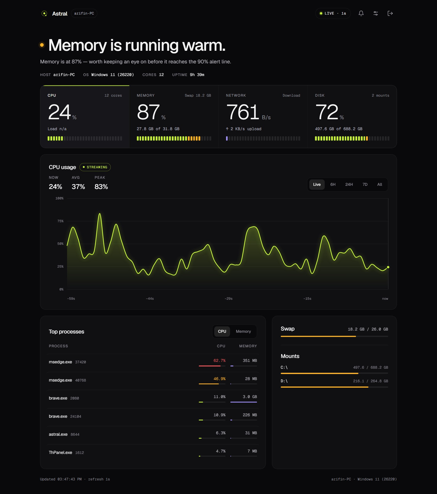

<h1 align="center">Astral</h1>

<p align="center"><b>A lightweight server monitoring dashboard in a single binary.</b></p>

<p align="center">
  
</p>

<p align="center">
  <a href="https://github.com/arifintahu/astral/actions/workflows/ci.yml"></a>
  <a href="https://github.com/arifintahu/astral/releases"></a>
  <a href="https://github.com/arifintahu/astral/stargazers"></a>
  <a href="LICENSE"></a>
</p>

Astral is a pragmatic, ultra-lightweight server monitoring dashboard. It bridges the gap between basic CLI tools like `htop` and complex observability stacks like Prometheus/Grafana.

It serves a modern single-page web UI with real-time system health and historical trends, secured by default, with built-in webhook alerting. Everything is packaged into one binary: Rust on the server, Svelte in the browser, SQLite for history. No account, no telemetry.



## Features

-   **Real-time Monitoring:** Live updates (1-second intervals) for CPU, Memory, Network, and Disk usage via Server-Sent Events (SSE).
-   **At-a-glance Status:** A one-line headline ("All systems nominal." or "CPU is running hot.") that follows the CPU and memory alert thresholds you configure, above four metric tiles (CPU, Memory, Network, Disk) that also switch the main chart.
-   **Historical Data:** An interactive chart that starts on a live 60-second stream and switches to 6 hours, 24 hours, 7 days, or all retained history, backed by an embedded SQLite database.
-   **Single Binary Deployment:** The Svelte frontend is embedded directly into the Rust binary. No external runtime dependencies (Node.js, Python, etc.) required on the host.
-   **Secure by Default:** HMAC-SHA256 session tokens with per-login nonces, `HttpOnly; SameSite=Strict` cookies, Argon2 password hashing, login rate limiting, server-side session revocation, and a full set of security headers (CSP, HSTS, X-Frame-Options).
-   **Alerting:** Configurable webhook alerts (HTTPS only) for high CPU or memory usage (sustained 5 minutes), with a 15-minute per-kind cooldown to prevent alert floods.
-   **Settings without a restart:** Alert thresholds, process monitoring, retention and the Slack webhook can be changed from the dashboard.
-   **Lightweight:** About 7 MB of memory and close to no CPU while idle, measured on a real 4-vCPU VPS (see [Resource use](#resource-use)). Designed for small to medium-sized VPS and servers.

## Why Astral

`htop` shows you the moment you are looking; Prometheus and Grafana answer every question but ask you to run and maintain several services. Astral keeps one job: show what your server is doing now and over the last few days, and tell you when it stays hot. One file to copy, one port to open behind your reverse proxy, and nothing to configure beyond a login.

## Resource use

Astral is meant to disappear on a small server, so these numbers come from a real one.

**Test environment:** a VPS with 4 vCPUs (AMD EPYC) and 7.9 GB RAM, running Ubuntu 24.04 and shared with other workloads. The Linux (amd64) release binary was started with a fresh database, left to warm up for 20 seconds, then measured over 60 seconds. Each figure is the median of three runs. CPU is the server's own CPU time as a share of one core, so other tenants do not count.

| Scenario | CPU | Memory (RSS) |
| :--- | :---: | :---: |
| Idle, no browser open | 0.03% | 7.2 MB |
| Idle, process list on | 0.27% | 7.6 MB |
| One signed-in dashboard open, process list on | 2.27% | 7.7 MB |

- **Spread across the three runs:** 0.03% to 0.08% idle, 0.15% to 0.48% idle with the process list on, and 2.2% to 2.7% with a dashboard open. With a dashboard open and the process list off (the default), CPU is about 0.4%.
- **Threads:** 5.
- **Peak memory** (`VmHWM`): 13.9 MB at startup, from the one-time 9 MiB Argon2 password hash. A signed-in dashboard peaks at 15.7 MB.
- **What the 7 MB is:** about 1 MB of heap. The rest is the program's own code and the shared C library, clean pages that the kernel can drop under memory pressure.
- **Binary:** 7.0 MB. **Time to ready:** about 0.25 to 0.3 s, almost all of it that startup hash.
- **Bandwidth:** about 1.7 KB/s for each open dashboard.

When nobody has the dashboard open, Astral samples every 10 seconds instead of every second, and history and alerts use time-weighted averages so they stay accurate. The process list is rescanned every 3 seconds, because reading every process is the most expensive thing Astral does. A dashboard that connects gets its first update within about a second. `./benchmark.sh` reproduces the idle row on your own machine.

## Install

### Download Binary

Pre-built binaries for Linux (amd64, glibc 2.35 or newer, so Ubuntu 22.04 and Debian 12 work), Windows (amd64), and macOS (Apple Silicon) are available on the [Releases](https://github.com/arifintahu/astral/releases) page.

1.  Download the latest release for your platform.
2.  Make the binary executable (Linux/macOS):
    ```bash
    chmod +x astral-<version>-linux-amd64
    ```
3.  Run it:
    ```bash
    ./astral-<version>-linux-amd64
    ```

### Docker Deployment

For production environments, deploying via Docker ensures a consistent runtime and easy updates.

The provided `docker-compose.yml` runs Astral with `pid: host` and read-only `/proc` and `/sys` mounts so it can see the host system, and binds the port to `127.0.0.1`.

1.  **Set credentials via environment variable:**
    ```bash
    cp .env.example .env
    # Set ASTRAL_AUTH=youruser:yourpassword in .env
    ```

2.  **Start the service:**
    ```bash
    docker-compose up -d --build
    ```

3.  **Access the dashboard:**
    Open `http://127.0.0.1:8080`. To reach it from other machines, put a TLS-terminating reverse proxy in front — see [TLS](#tls) below.

**Important Notes:**
-   **Host Monitoring:** Astral needs `pid: host` (or `--pid host`) along with the `/proc` and `/sys` mounts to monitor the host's CPU, memory and processes from within a container. For the host's network traffic, run the container with `network_mode: host` (see the comments in `docker-compose.yml`). Without these, it only monitors the container's isolated environment.
-   **Data Persistence:** The SQLite database is stored in `/app/data` inside the container. Use a volume (e.g., `astral_data`) to persist historical data across restarts.
-   **Credentials:** Pass `ASTRAL_AUTH=user:pass` as an environment variable rather than a CLI flag. This keeps the password out of `docker inspect` output and process lists.

### Build from Source

To build Astral from source, you need:
-   **Rust:** Latest stable version (install via [rustup](https://rustup.rs/)).
-   **Node.js & npm:** For building the frontend assets.

1.  **Clone the repository:**
    ```bash
    git clone https://github.com/arifintahu/astral.git
    cd astral
    ```

2.  **Build the Frontend:**
    ```bash
    cd web
    npm install
    npm run build
    cd ..
    ```

3.  **Build & Run the Backend:**
    ```bash
    cargo run --release
    ```

    Or build a release binary:
    ```bash
    cargo build --release
    # Binary will be at target/release/astral
    ```

## Usage

By default, Astral listens on port `8080`.

```bash
./astral [OPTIONS]
```

### Configuration

Credentials can be supplied via environment variable (recommended — avoids exposing the password in `ps` output and shell history) or via the `--auth` flag:

```bash
# Preferred: environment variable
ASTRAL_AUTH=admin:secret123 ./astral

# Alternative: flag (visible in process list — avoid on shared hosts)
./astral --auth admin:secret123
```

If neither is provided, Astral generates random credentials and prints them once to stderr on startup.

### Flags

| Flag | Env var | Description | Default |
| :--- | :--- | :--- | :--- |
| `--port <PORT>` | — | Port to listen on. | `8080` |
| `--auth <USER:PASS>` | `ASTRAL_AUTH` | Login credentials. | auto-generated |
| `--retention <DAYS>` | — | Days of history to keep. | `7` |
| `--webhook <URL>` | — | HTTPS webhook URL for alerts. | `None` |
| `--slack-webhook <URL>` | — | Slack incoming webhook URL for alerts. | `None` |
| `--alert-cpu <%>` | — | CPU threshold for alerts (0–100). | `90` |
| `--alert-ram <%>` | — | Memory threshold for alerts (0–100). | `90` |
| `--enable-process-list` | — | Include top processes in the live feed. | off |

> **Note:** `--webhook` only accepts `https://` URLs. HTTP webhook URLs are rejected to prevent SSRF.

### Examples

**Run with default settings (auto-generated credentials printed to stderr):**
```bash
./astral
```

**Run with custom credentials and port:**
```bash
ASTRAL_AUTH=admin:secret123 ./astral --port 3000
```

**Run with webhook alerting and process list enabled:**
```bash
ASTRAL_AUTH=admin:secret123 ./astral \
  --webhook https://discord.com/api/webhooks/... \
  --alert-cpu 80 \
  --enable-process-list
```

## TLS

Astral does not terminate TLS itself. For any network-exposed deployment, place it behind a reverse proxy that handles TLS:

**Caddy** (automatic HTTPS):
```caddyfile
monitor.example.com {
    reverse_proxy localhost:8080
}
```

**nginx:**
```nginx
server {
    listen 443 ssl;
    server_name monitor.example.com;
    ssl_certificate     /etc/ssl/certs/cert.pem;
    ssl_certificate_key /etc/ssl/private/key.pem;

    location / {
        proxy_pass http://127.0.0.1:8080;
        proxy_set_header X-Forwarded-Proto https;
    }
}
```

Without TLS, the session cookie and login credentials are transmitted in plaintext.

## Development

Prerequisites: [Rust](https://rustup.rs/) (stable), [Node.js](https://nodejs.org/) 20+ and npm.

```sh
git clone https://github.com/arifintahu/astral
cd astral
cd web && npm ci && npm run build && cd ..   # the frontend is embedded into the binary
cargo run -- --auth admin:secret --port 3000
```

```sh
cargo test                                 # Rust tests
cargo fmt --check && cargo clippy --all-targets -- -D warnings
cd web && npm run build                    # frontend build and type-check
node scripts/version.mjs check             # one version across Cargo.toml and web/
```

The binary embeds `web/dist`, so rebuild the frontend before `cargo build`. `cd web && npm run dev` starts Vite with hot reload for UI work, but it has no `/api` proxy, so it cannot sign in. See [CONTRIBUTING.md](CONTRIBUTING.md) for code style, pull requests, versioning and releases.

## Project structure

```
src/        Rust backend: server and auth (main.rs), SSE, history and settings API (api.rs),
            metrics collector (metrics.rs), aggregation and alerts (worker.rs), SQLite (db.rs)
web/        Svelte 5 frontend, built to web/dist and embedded into the binary
scripts/    version.mjs (one version for the repo) and release-notes.mjs (release body)
```

[CLAUDE.md](CLAUDE.md) has the architecture and rules of thumb.

## Docs and contributing

[Contributing](CONTRIBUTING.md) · [Architecture](CLAUDE.md) · [Changelog](CHANGELOG.md) · [Security](SECURITY.md)

Every release lists its pull requests and contributors in the [release notes](https://github.com/arifintahu/astral/releases).

## License

[MIT](LICENSE).
